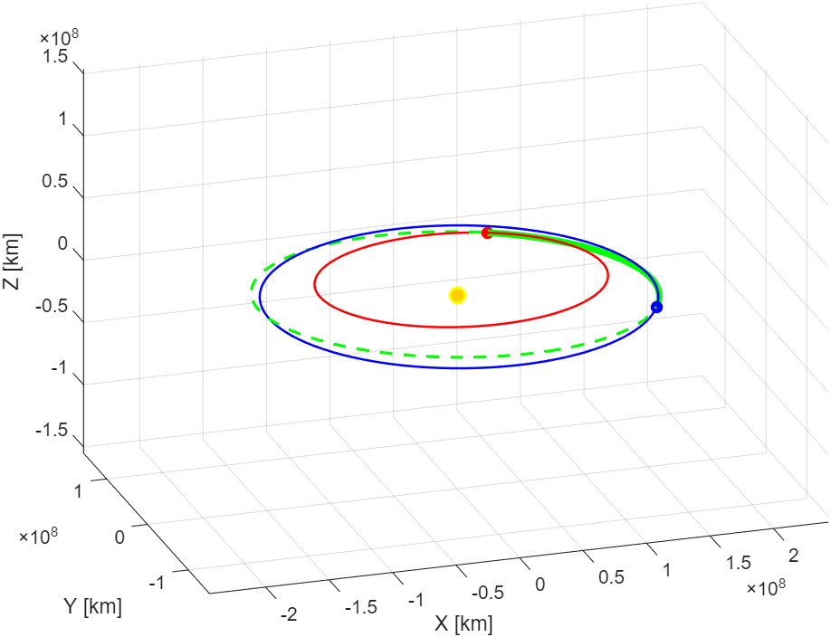

# Laboratorio di Analisi di Missioni Spaziali

**Da un'orbita di trasferimento geostazionaria all'asteroide 363505 (2003 UC20)**  
Progetto di Ingegneria Aerospaziale · Politecnico di Milano · A.A. 2025–2026



Il progetto confronta sequenze di manovre impulsive e strategie di ottimizzazione per una missione verso un asteroide near-Earth di classe Aten. Il modello a coniche raccordate collega il trasferimento geocentrico, il tratto eliocentrico e le manovre di fuga e cattura.

| Scenario | Analisi | MATLAB |
| --- | --- | --- |
| **1 · Orbita di parcheggio** | Trasferimenti bitangenti, cambio di piano e di argomento del pericentro, circolarizzazione intermedia | [Script](matlab/scenario_1/) |
| **2 · Trasferimento eliocentrico** | Ricerca a griglia adattiva, algoritmo genetico e particle swarm optimization | [Script](matlab/scenario_2/) |
| **3 · Fuga e cattura** | Iperbole di fuga dalla Terra e inserimento in orbita circolare o ellittica attorno all'asteroide | [Script](matlab/scenario_3/) |

La soluzione di riferimento riportata nell'elaborato richiede circa **11,89 km/s di ΔV** e **212 giorni** di missione.

## Elaborati e risultati

- [Report finale](docs/Report_finale.pdf) · [Presentazione](docs/slide/Presentazione_LAMS.pptx) · [Dispensa di teoria](docs/Dispensa_teoria.pdf)
- [Animazioni delle manovre](media/animazioni/) · [Grafici e figure](media/figure/)
- [Versioni precedenti delle slide](docs/slide/) · [Riferimenti bibliografici](docs/Riferimenti.md)

## Esecuzione in MATLAB

Aprire MATLAB nella cartella principale del repository e aggiungere i percorsi del progetto. Poi eseguire lo script dello scenario desiderato.

```matlab
run("matlab/avvia.m")
ottimizzatore
```

Gli script `Scenario_2_ga` e `Scenario2_pso` usano **Global Optimization Toolbox** e **Optimization Toolbox**. `Scenario_3_nonpiano` usa **Optimization Toolbox** per `fsolve`. La ricerca a griglia e le ottimizzazioni stocastiche possono richiedere tempi di calcolo lunghi. Gli script dello scenario 3 leggono il risultato precalcolato del trasferimento da [matlab/dati](matlab/dati/). I prototipi precedenti sono in [matlab/esperimenti](matlab/esperimenti/).

## Autori e diritti

Amr Abou Eish, Simone Amoruso e Filippo Antonioni.  
Docenti di riferimento: Mauro Massari e Fabio Ferrari.

Per l'attribuzione e il riuso degli elaborati e del codice, consultare [COPYRIGHT.md](COPYRIGHT.md).
