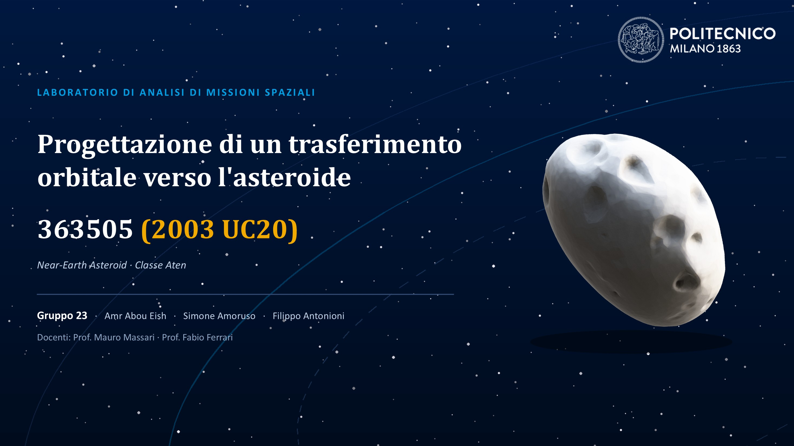

# Laboratorio_Analisi_Missioni_Spaziali

Repo degli script matlab e delle animazioni per il lab di Analisi di Missioni Spaziali presso il Politecnico di Milano

Membri:

Filippo Antonioni
Amoruso Simone
Amr Abou Eish
